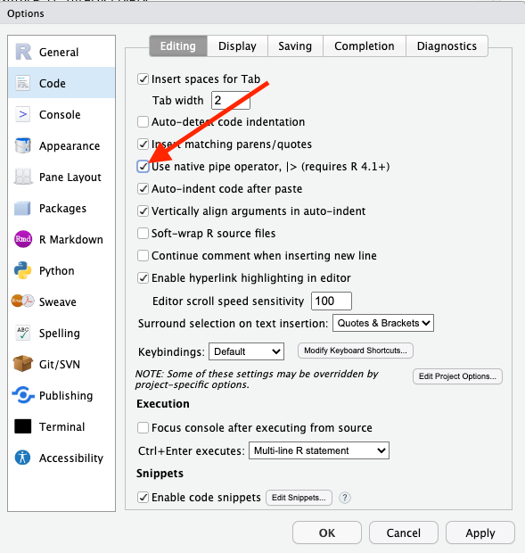

## Libraries

R is a statistical programming language that is purpose built for data analysis.

Base R does a lot, but there are a mountain of external libraries that do things to make R better/easier/more fully featured. We already installed the tidyverse -- or you should have if you followed the instructions for the last assignment -- which isn't exactly a library, but a collection of libraries. Together, they make up the Tidyverse. Individually, they are extraordinarily useful for what they do. We can load them all at once using the tidyverse name, or we can load them individually. Let's start with individually.

The two libraries we are going to need for this assignment are `readr` and `dplyr`. The library `readr` reads different types of data in. For this assignment, we're going to read in csv data or Comma Separated Values data. That's data that has a comma between each column of data.

Then we're going to use `dplyr` to analyze it.

To use a library, you need to import it. Good practice -- one I'm going to insist on -- is that you put all your library steps at the top of your notebooks.

That code looks like this:

```{r}
library(readr)
```

To load them both, you need to do this:

```{r}
library(readr)
library(dplyr)
```

But, because those two libraries -- and several others that we're going to use over the course of this class -- are so commonly used, there's a shortcut to loading all of the libraries we'll need:

```{r}
#| output: false
library(tidyverse)
```

You can keep doing that for as many libraries as you need.

## Importing data

The first thing we need to do is get some data to work with. We do that by reading it in. In our case, we're going to read a datatable from an "rds" file, which is a format for storing data with R. Later in the course, we'll more frequently work with a format called a CSV. A CSV is a stripped down version of a spreadsheet you might open in a program like Excel, in which each column is separated by a comma. RDS files are less common when getting data from other people. But reading in CSVs is less foolproof than reading in rds files, so for now we'll work with rds.

The rds file we're going to read in contains information about the Maryland doctors, nurse practitioners, dentists and other health care providers who wrote prescriptions for Medicare patients from 2022 through 2024. It comes from the federal Centers for Medicare & Medicaid Services, which publishes a [file every year](https://data.cms.gov/provider-summary-by-type-of-service/medicare-part-d-prescribers) summarizing the prescriptions each provider wrote under Medicare's prescription drug program, called Part D.

So step 1 is to import the data. The code to import the data looks like this:

`md_prescribers <- read_rds("md_partd_prescribers.rds")`

Let's unpack that.

The first part -- **md_prescribers** -- is the name of a variable.

A **variable** is just a name that we'll use to refer to some more complex thing. In this case, the more complex thing is the data we're importing into R that will be stored as a **dataframe**, which is one way R stores data.

We can call this variable whatever we want. The variable name doesn't matter, technically. We could use any word. You could use your first name, if you like. Generally, though, we want to give variables names that are descriptive of the thing they refer to. Which is why we're calling this one **md_prescribers**. Variable names, by convention are one word all lower case (or two or more words connected by an underscore). You can end a variable with a number, but you can't start one with a number.

The `<-` bit, you'll recall from the basics, is the **variable assignment operator**. It's how we know we're assigning something to a word. Think of the arrow as saying "Take everything on the right of this arrow and stuff it into the thing on the left." So we're creating an empty vessel called **md_prescribers** and stuffing all this data into it.

**read_rds()** is a function, one that only works when we've loaded the tidyverse. A **function** is a little bit of computer code that takes in information and follows a series of pre-determined steps and spits it back out. A recipe to make pizza is a kind of function. We might call it **make_pizza()**.

The function does one thing. It takes a preset collection of ingredients -- flour, water, oil, cheese, tomato, salt -- and passes them through each step outlined in a recipe, in order. Things like: mix flour and water and oil, knead, let it sit, roll it out, put tomato sauce and cheese on it, bake it in an oven, then take it out.

The output of our **make pizza()** function is a finished pie.

We'll make use of a lot of pre-written functions from the tidyverse and other packages, and even write some of our own. Back to this line of code:

`md_prescribers <- read_rds("md_partd_prescribers.rds")`

Inside of the **read_rds()** function, we've put the name of the file we want to load. Things we put inside of function, to customize what the function does, are called **arguments**.

The easiest thing to do, if you are confused about how to find your data, is to put your data in the same folder as as your notebook (you'll have to save that notebook first). If you do that, then you just need to put the name of the file in there (md_partd_prescribers.rds). If you put your data in a folder called "data" that sits next to your data notebook, your function would instead look like this:

```{r}
md_prescribers <- read_rds("data/md_partd_prescribers.rds")
```

In this data set, each row represents one prescriber in one year: their name, credentials, city and ZIP code, their specialty and how many prescriptions -- "claims," in Medicare's language -- they wrote for Medicare patients that year. There are also columns for the total cost of those drugs, the number of opioid prescriptions and the share of all prescriptions that were for opioids, which Medicare calls the opioid prescribing rate.

One important thing to know up front: to protect patient privacy, CMS leaves out any prescriber with fewer than 11 claims in a year. That means this isn't every health care provider in Maryland; it's every one who wrote at least 11 prescriptions for Medicare patients. Knowing what's *not* in a dataset is just as important as knowing what is.

After loading the data, it's a good idea to get a sense of its shape. What does it look like? There are several ways we can examine it.

By looking in the R Studio environment window, we can see the number of rows (called "obs.", which is short for observations), and the number of columns (called variables). We can double click on the dataframe name in the environment window, and explore it like a spreadsheet.

There are several useful functions for getting a sense of the dataset right in our markdown document.

If we run `glimpse(md_prescribers)`, it will give us a list of the columns, the data type for each column and and the first few values for each column.

```{r}
glimpse(md_prescribers)
```

If we type `head(md_prescribers)`, it will print out the columns and the first six rows of data.

```{r}
head(md_prescribers)
```

We can also click on the data name in the R Studio environment window to explore it interactively.

## Group by and count

So what if we wanted to know how many prescribers appear in each year?

To do that by hand, we'd have to take each of the 79,625 individual rows (or observations or records) and sort them into a pile. We'd put them in groups -- one for each year -- and then count them.

`dplyr` has a group by function in it that does just this. A massive amount of data analysis involves grouping like things together and then doing simple things like counting them, or averaging them together. So it's a good place to start.

So to do this, we'll take our dataset and we'll introduce a new operator: `|>`. The best way to read that operator, in my opinion, is to interpret that as "and then do this." This is called the "pipe operator" and it's a huge part of writing R statements. So much so that there's a keyboard shortcut for this: cmd-shift-m on the Mac and ctrl-shift-m on Windows. In order to enable this shortcut, you'll need to set an option under Tools -\> Global Options, in the "Code" section. Make sure you check the box labeled "Use native pipe operator" and then click "Apply", like so:



Don't like that character? R also has one that does the same thing: `%>%`. They both work.

We're going to establish a pattern that will come up again and again throughout this book: `data |> function`. In English: take your data set and then do this specific action to it.

The first step of every analysis starts with the data being used. Then we apply functions to the data.

In our case, the pattern that you'll use many, many times is: `data |> group_by(COLUMN NAME) |> summarize(VARIABLE NAME = AGGREGATE FUNCTION(COLUMN NAME))`

In our dataset, the column with year information is called "year"

Here's the code to count the number of prescribers in each year:

```{r}
md_prescribers |>
  group_by(year) |>
  summarise(
    count_prescribers = n()
  )
```

So let's walk through that.

We start with our dataset -- `md_prescribers` -- and then we tell it to group the data by a given field in the data. In this case, we wanted to group together all the years, signified by the field name `year`, which you could get from using the glimpse() function. After we group the data, we need to count them up.

In dplyr, we use the `summarize()` function, [which can do alot more than just count things](http://dplyr.tidyverse.org/reference/summarise.html).

Inside the parentheses in summarize, we set up the summaries we want. In this case, we just want a count of the number of prescribers for each year grouping. The line of code `count_prescribers = n(),` says create a new field, called `count_prescribers` and set it equal to `n()`. `n()` is a function that counts the number of rows or records in each group. Why the letter n? The letter n is a common symbol used to denote a count of something. The number of things (or rows or observations or records) in a dataset? Statisticians call it n. There are n number of prescribers in this dataset.

When we run that, we get a list of years with a count next to them. But it's not in any order.

So we'll add another "and then do this" symbol -- \|\> -- and use a new function called `arrange()`. Arrange does what you think it does -- it arranges data in order. By default, it's in ascending order -- smallest to largest. But if we want to know the year with the most prescribers, we need to sort it in descending order. That looks like this:

```{r}
md_prescribers |>
  group_by(year) |>
  summarise(
    count_prescribers = n()
  ) |>
  arrange(desc(count_prescribers))
```

2024 has the most prescribers, and the number has grown each year. That's worth a question: are there more providers in Maryland, or are more of them treating Medicare patients?

We can, if we want, group by more than one thing. The prescriber data contains a column detailing each provider's specialty.

We can group by "year" and "specialty" to see how many prescribers of each specialty appear in each year. We'll sort by year and specialty.

```{r}
md_prescribers |>
  group_by(year, specialty) |>
  summarise(
    count_prescribers = n()
  ) |>
  arrange(year, specialty)
```

## Other summarization methods: summing, mean, median, min and max

In the last example, we grouped like records together and counted them, but there's so much more we can do to summarize each group.

Let's say we wanted to know the total number of prescriptions written in each year? For that, we could use the `sum()` function to add up all of the values in the column "total_claims". We put the column we want to total -- "total_claims" -- inside the sum() function `sum(total_claims)`. Note that we can simply add a new summarize function here, keeping our count_prescribers field in our output table.

```{r}
md_prescribers |>
  group_by(year) |>
  summarise(
    count_prescribers = n(),
    total_claims = sum(total_claims)
  ) |>
  arrange(desc(total_claims))
```

We can also calculate the average number of prescriptions per prescriber -- the mean -- and the number that sits at the midpoint of our data -- the median.

```{r}
md_prescribers |>
  group_by(year) |>
  summarise(
    count_prescribers = n(),
    total_claims = sum(total_claims),
    mean_claims = mean(total_claims),
    median_claims = median(total_claims)
  ) |>
  arrange(desc(total_claims))
```

Wait. Something is off. The mean and the median are the same as the total, and that can't be right. What happened? Inside `summarise()`, we created a new column called `total_claims` -- the same name as the column we were summarizing. Once we did that, every calculation after it used our new, summed-up value instead of the original column. This is an easy mistake to make, and a good reminder to give your new columns names that are different from the ones in your data. Let's fix it:

```{r}
md_prescribers |>
  group_by(year) |>
  summarise(
    count_prescribers = n(),
    sum_claims = sum(total_claims),
    mean_claims = mean(total_claims),
    median_claims = median(total_claims)
  ) |>
  arrange(desc(sum_claims))
```

We see something interesting here. The mean number of prescriptions is much higher than the median -- more than four times as high. That tells us that a relatively small number of prescribers write a very large number of prescriptions, pulling the average up. Examining both the median -- which is less sensitive to extreme values -- and the mean -- which is more sensitive to extreme values -- gives you a clearer picture of the composition of the data.

What about the highest and lowest number of prescriptions for each specialty? For that, we can use the `min()` and `max()` functions.

```{r}
md_prescribers |>
  group_by(specialty) |>
  summarise(
    count_prescribers = n(),
    sum_claims = sum(total_claims),
    mean_claims = mean(total_claims),
    median_claims = median(total_claims),
    min_claims = min(total_claims),
    max_claims = max(total_claims)
  ) |>
  arrange(desc(sum_claims))
```

From this, we can see that the minimum for nearly every specialty is 11 -- that's the privacy cutoff we talked about earlier, not a real pattern in prescribing. The variation in mean and median prescriptions is interesting, too: look at Family Practice and Cardiology compared to Nurse Practitioner and Physician Assistant, for example. These patterns aren't random: specialists who manage chronic conditions in older patients write a lot of prescriptions, while many nurse practitioners and physician assistants work in settings that serve fewer Medicare patients.

It would be interesting to see which prescriber has the largest number of prescriptions. To do that, we could simply take our original data set and sort it from highest to lowest on total_claims

```{r}
md_prescribers |>
  arrange(desc(total_claims))
```

One family practice physician in Baltimore wrote more than 88,000 Medicare prescriptions in 2024 -- more than twice as many as anyone else in the state. Is that a large practice billing under one doctor's name? A physician who serves many nursing homes? Something else? Data like this doesn't answer those questions, but it tells you exactly where to start reporting.
