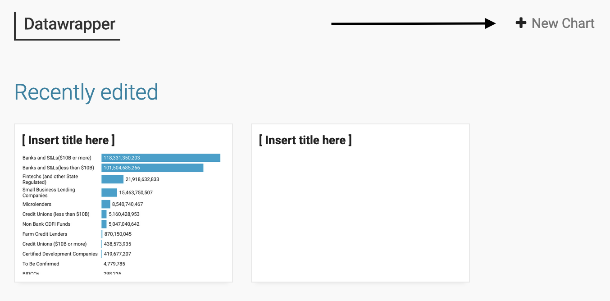
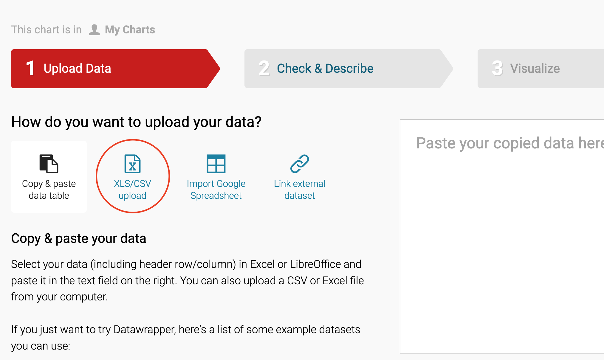
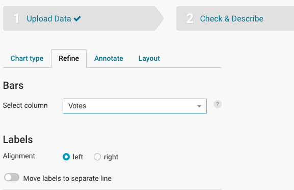
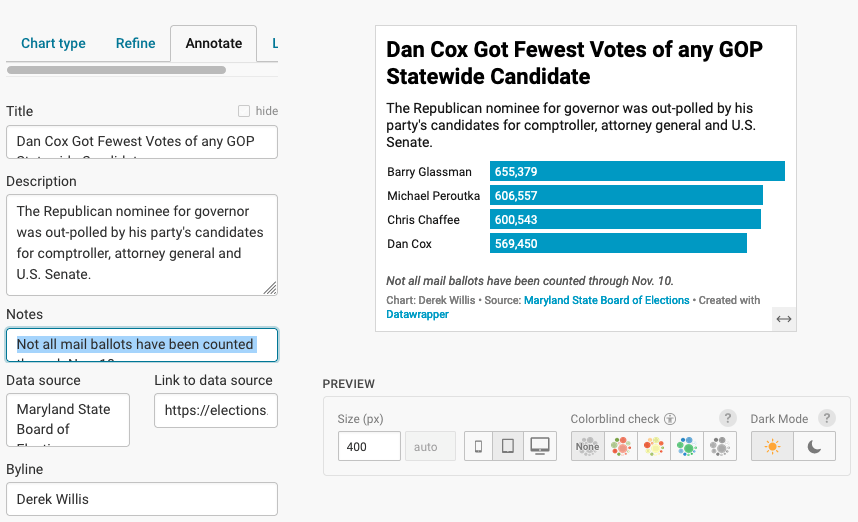
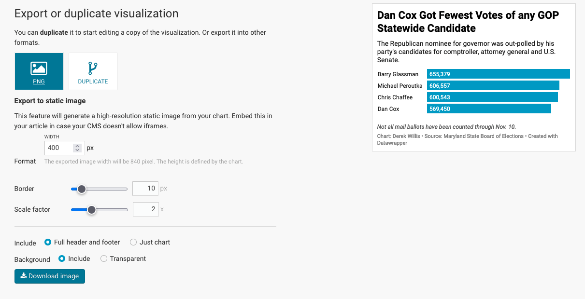
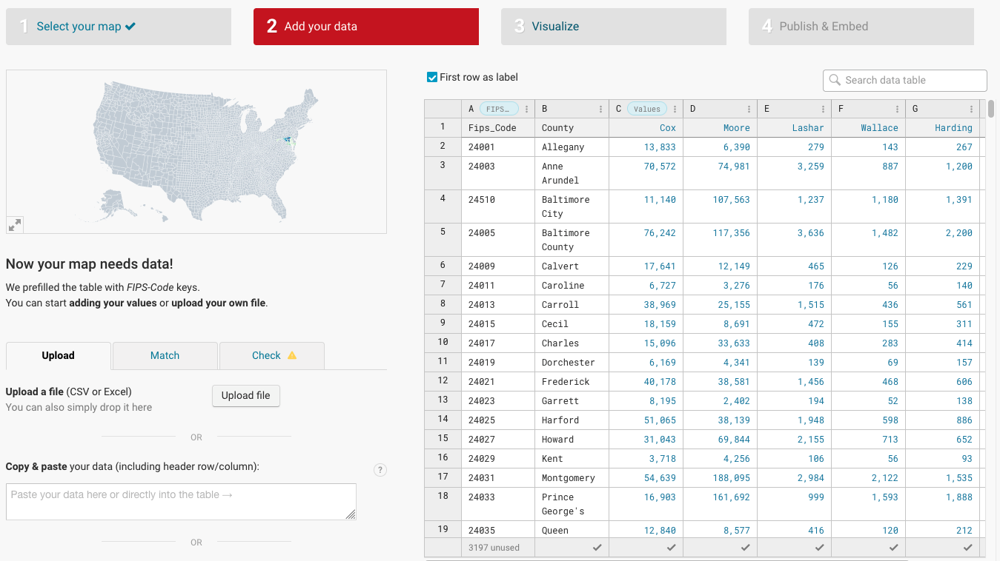
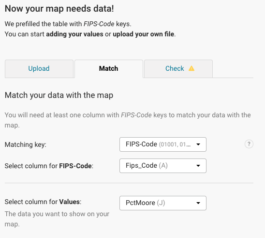

```{r setup, include=FALSE}
knitr::opts_chunk$set(echo = TRUE)
```

### Task 1: Load libraries and settings

**Task** Run the following code in the gray-colored codeblock below to load the tidyverse library

```{r}
library(tidyverse)
library(janitor)
```

### Task 2: Get Maryland nursing home ownership data

First, let's get some data and work with it. Let's use a simple CSV summarizing Maryland's 221 nursing homes by who owns them -- for-profit companies, nonprofits or government -- with the number of homes and beds, the total fines they've paid and their average rating on the federal government's five-star scale. Let's look at it.

**Task** Load the Maryland nursing home ownership CSV file

```{r}
md_nursing_home_owners <- read_csv("data/md_nursing_home_owners.csv")
```

### Task 3: Log into Datawrapper

**Task** Log into [datawrapper.de](https://www.datawrapper.de/). Once logged in, you'll click on New Chart.

```{r, echo=FALSE}

```

### Task 4: Upload the CSV File

The first thing we'll do is upload the nursing home ownership CSV that's in the pre_lab_09/data folder. (The screenshots in this notebook come from an earlier example, so your column names will be different.)

**Task** Click on XLS/CSV and upload the md_nursing_home_owners.csv file.

```{r, echo=FALSE}

```

### Task 5: Inspect the Data

Next up is to check and see what Datawrappper did with our data when we uploaded it. As you can see from the text on the left, if it's blue, it's a number. If it's green, it's a date. If it's black, it's text. Red means there's a problem. This data is very clean, so it imports cleanly.

**Task** Look at the uploaded data, then click on the "Proceed" button.

```{r, echo=FALSE}
knitr::include_graphics(rep("images/datawrapper3.png"))
```

### Task 6: Make a Chart

Now we make a chart. Bar chart comes up by default, which is good, because with totals, that's what we have.

**Task** Click on Refine. The first option we want to change is column we're using for the bars, which defaults to "Nursing homes". Let's make it "Average rating":

```{r, echo=FALSE}

```

Let's also choose to sort the bars so that the largest value (and bar appears first). We do that by clicking on the "Sort bars" button.

### Task 7: Annotate the Chart

Now we need to annotate our charts. Every chart needs a title, a source line and a credit line. Most need chatter (called `description` here).

**Task** Click on the "Annotate" tab to get add the title and description. Really think about the title and description: the title is like a headline and the description is provides some additional context. Another way to think about it: the title is the most important lesson from the graphic, and the description could be the next most important lesson or could provide more context to the title.

```{r, echo=FALSE}

```

### Task 7: Publish the Chart

**Task** Click the "Publish & Embed" tab, then click on the "PNG" icon. Finally, click the "Download image" button and save that file in the pre_lab_09 folder.

```{r, echo=FALSE}

```

Some publication systems allow for the embedding of HTML into a post or a story. Some don't. The only way to know is to ask someone at your publication. Every publication system on the planet, though, can publish an image. So there's always a way to export your chart as a PNG file, which you can upload like any photo.

**Answer** Copy the url of the graphic you published here. It will begin with <https://datawrapper.dwcdn.net/>. Don't copy the browser's current url.

### Task 8: Make a Choropleth Map

Let's create a choropleth map - one that shows how the rate of opioid overdose deaths changed across Maryland counties between 2018 and 2023, using data from the Maryland Department of Health's State Health Improvement Plan. The rates are deaths per 100,000 residents. We'll read that in from the data folder.

**Task** Run the following code to load and look at the opioid death rate data. What do you notice about some of the values? What do you think they mean? **Answer**

```{r}
md_opioid_deaths <- read_csv("data/md_opioid_deaths_county.csv")
md_opioid_deaths
```

In order to make a map, we need to be able to tell Datawrapper that a certain column contains geographic information (besides the name of the county). The easiest way to do that for U.S. maps is to use something called a [FIPS Code](https://www.census.gov/programs-surveys/geography/guidance/geo-identifiers.html). You should read about them so you understand what they are, and think of them as a unique identifier for some geographical entity like a state or county. Our md_opioid_deaths dataframe has a FIPS code for each county, but if you ever need one for a county, this is a solved problem thanks to the tigris library, which we'll use in pre_lab 10.

The -999 values are counties where the state suppressed the rate because so few people died that the rate would be unreliable and could help identify them. If we mapped -999 as a number, those counties would look like they had by far the lowest death rates in the state. The `na_if()` function replaces a specific value with NA, which tells R and Datawrapper that the value is missing.

**Task** Write code that uses mutate and `na_if()` to replace -999 with NA in both rate columns, then adds a column called `change` showing the difference between the 2023 rate and the 2018 rate. Then save the result to a new CSV file in the data folder.

```{r}

# replace -999 with NA and calculate the change, saving it back to the md_opioid_deaths dataframe

write_csv(md_opioid_deaths, "data/md_opioid_deaths_with_change.csv")
```

**Task** Go back to Datawrapper and click on "New Map". Click on "Choropleth map" and then choose "USA \>\> Counties (2022)" for the map base and click the Proceed button.

**Task** Now we can upload the `md_opioid_deaths_with_change.csv` file from our data folder using the Upload File button. It should look like the following image:

```{r, echo=FALSE}

```

We'll need to make sure that Datawrapper understands what the data is and where the FIPS code is.

**Task** Click on the "Match" tab and make sure that yours looks like the image below (choose `fips_code` for the FIPS codes and `change` for the values):

```{r, echo=FALSE}

```

**Task** Click the "Proceed" button (you should have to click it twice, since the first time it will tell you that there's no data for 3,197 counties - the rest of the U.S.). That will take you to the Visualize tab.

You'll see that the map currently is of the whole nation, and we only have Maryland data. Let's fix that.

**Task** Look for "Hide regions without data" under Appearance, and click the slider icon to enable that feature. You should see a map zoomed into Maryland with some counties in various colors. **Answer** Describe the changes from the previous map

But it's a little rough visually, so let's clean that up.

**Task** Look for the "Show color legend" label and add a caption for the legend, which is the horizontal bar under the title. It represents the extent of the data from the largest decrease in the death rate to the largest increase. Because the values go from negative to positive, try a diverging color palette under "Colors". Then click on the "Annotate" tab to add a title, description, data source and byline. The title should represent the headline, while the description should be a longer phrase that tells people what they are looking at.

That's better, but check out the tooltip by hovering over a county. It's not super helpful. Let's change the tooltip behavior to show the county name and a better-formatted number.

**Task** Click the "Customize tooltips" button so it expands down. Change {{ fips_code }} to {{ county }} and {{ change }} to {{ FORMAT(change, "+0.0") }} deaths per 100,000 **Answer** Describe the changes from the previous map

**Task** Add a note explaining that the state does not publish rates for counties with very few deaths, and an alternative description for screen readers. This should be a simple description of what your map shows. Experiment with the "Show labels" button, choosing the "by column" option for Type to display some or all of the county names.

Ok, that looks better. Let's publish!

**Task** Click the "Proceed" button until you get to the "Publish & Embed" tab, then click "Publish Now". Copy the published URL (like you did for the chart above) and paste it below. **Answer** Put the URL of your map here.
