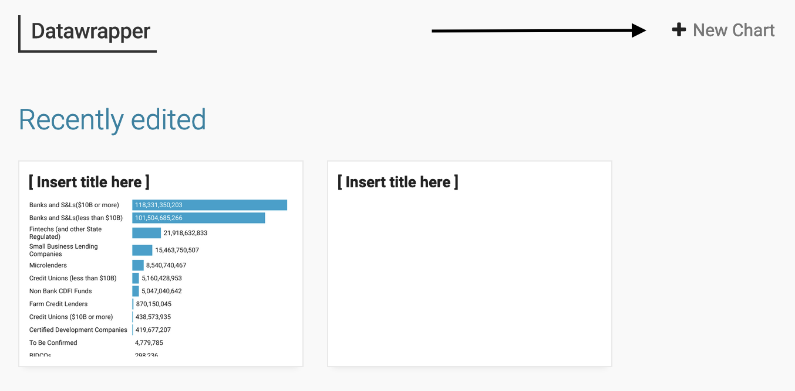
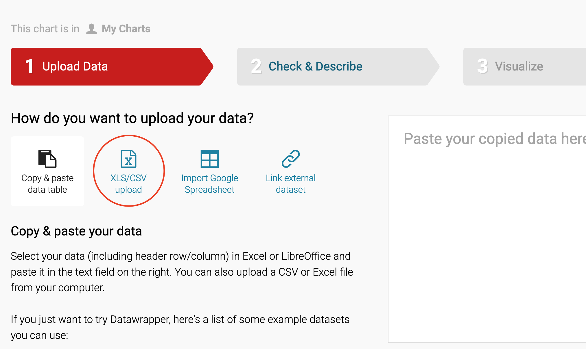
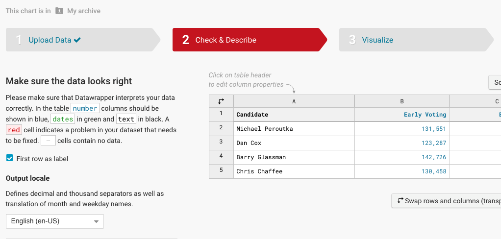
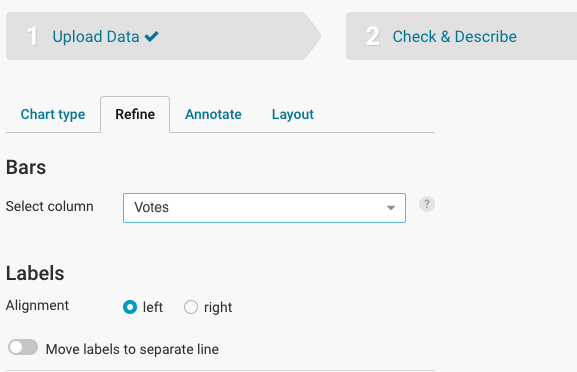
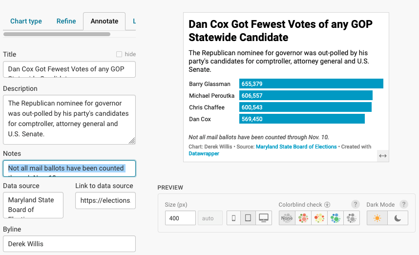
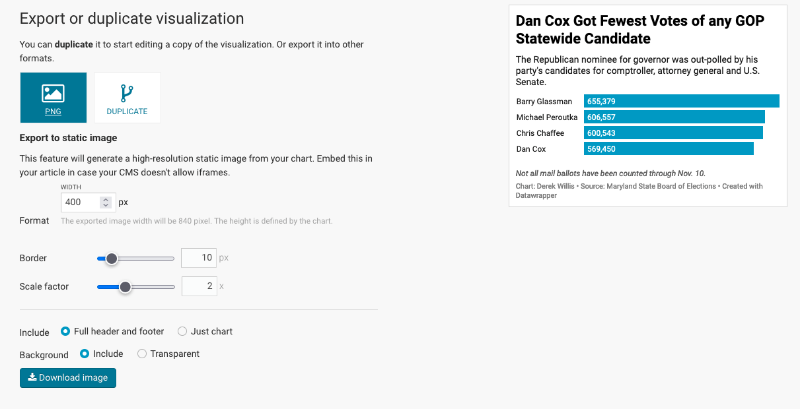
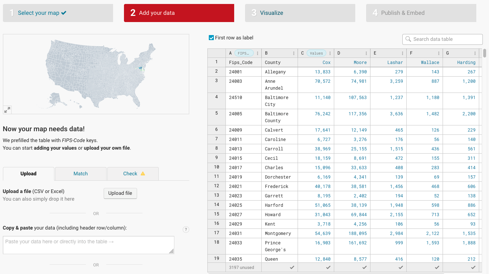

Doing data visualization well, and at professional level, takes time, skill and practice to perfect. Understanding it and doing it at a complex level is an entire class on it's own. It uses some of the same skills here -- grouping, filtering, calculating -- but then takes that data and turns it into data pictures.

But simple stuff -- and even some slightly complicated stuff -- can be done with tools made for people who aren't data viz pros.

The tool we're going to use is called [Datawrapper](https://www.datawrapper.de/).

First, let's get some data and work with it. Let's use a simple CSV summarizing Maryland's nursing homes by who owns them -- for-profit companies, nonprofits or government -- with the number of homes and beds, the total fines they've paid and their average rating on the federal government's five-star scale. Let's look at it.

```{r}
#| output: false
library(tidyverse)
```

```{r, message=FALSE}
md_nursing_home_owners <- read_csv("data/md_nursing_home_owners.csv")
```

```{r}
head(md_nursing_home_owners)
```

## Datawrapper

Making charts in Datawrapper is preposterously simple, which is the point. There are dozens of chart types, and dozens of options. To get from a csv to a chart to publication is very, very easy.

First, go to [datawrapper.de](https://www.datawrapper.de/) and sign up for an account. It's free.

Once logged in, you'll click on New Chart. (The screenshots in this chapter come from an earlier example, so the column names you see will be different from the ones in the images.)

```{r, echo=FALSE}

```

The first thing we'll do is upload our CSV. Click on XLS/CSV and upload the file.

```{r, echo=FALSE}

```

Next up is to check and see what Datawrappper did with our data when we uploaded it. As you can see from the text on the left, if it's blue, it's a number. If it's green, it's a date. If it's black, it's text. Red means there's a problem. This data is very clean, so it imports cleanly. Click on the "Proceed" button.

```{r, echo=FALSE}

```

Now we make a chart. Bar chart comes up by default, which is good, because with a few groups to compare, that's what we want.

Click on Refine. The first option we want to change is column we're using for the bars, which defaults to "Nursing homes". Let's make it "Average rating". Let's also choose to sort the bars so that the largest value (and bar) appears first. We do that by clicking on the "Sort bars" button.

```{r, echo=FALSE}

```

Now we need to annotate our charts. Every chart needs a title, a source line and a credit line. Most need chatter (called description here). Click on the "Annotate" tab to get started.

Really think about the title and description: the title is like a headline and the description is provides some additional context. Another way to think about it: the title is the most important lesson from the graphic, and the description could be the next most important lesson or could provide more context to the title.

```{r, echo=FALSE}

```

To publish, we click the "Publish & Embed" tab. Some publication systems allow for the embedding of HTML into a post or a story. Some don't. The only way to know is to ask someone at your publication. Every publication system on the planet, though, can publish an image. So there's always a way to export your chart as a PNG file, which you can upload like any photo.

```{r, echo=FALSE}

```

### Making a Map

Let's create a choropleth map - one that shows how the rate of opioid overdose deaths changed across Maryland counties between 2018 and 2023. The data comes from the Maryland Department of Health's State Health Improvement Plan, which tracks dozens of health measures by county. We'll read that in from the data folder.

```{r, message=FALSE}
md_opioid_deaths <- read_csv("data/md_opioid_deaths_county.csv")
```

In order to make a map, we need to be able to tell Datawrapper that a certain column contains geographic information (besides the name of the county). The easiest way to do that for U.S. maps is to use something called a [FIPS Code](https://www.census.gov/programs-surveys/geography/guidance/geo-identifiers.html). You should read about them so you understand what they are, and think of them as a unique identifier for some geographical entity like a state or county. Our md_opioid_deaths dataframe has a FIPS code for each county, but if you ever need one for a county, this is a solved problem thanks to the tigris library, which we'll use in the chapters on maps.

Before we map anything, let's look at the data:

```{r}
md_opioid_deaths
```

The rates are deaths per 100,000 residents. But what's going on with -999? When only a handful of people in a small county die of an overdose in a year, the state doesn't publish the rate, because a rate based on very small numbers can swing wildly from year to year and could help identify the people who died. Instead of leaving those cells blank, the state put in -999. That's a common practice -- but if we mapped it, Datawrapper would treat -999 as a real number, and those counties would look like they had the lowest death rates in the state, by a lot.

So we need to write code to replace those values with NA, which tells R (and Datawrapper) that the value is missing. The `na_if()` function does exactly that. Then we'll add a column showing the change in the death rate between 2018 and 2023, and save the result to a new CSV file in the data folder:

```{r}
md_opioid_deaths <- md_opioid_deaths |>
  mutate(rate_2018 = na_if(rate_2018, -999), rate_2023 = na_if(rate_2023, -999)) |>
  mutate(change = rate_2023 - rate_2018)
write_csv(md_opioid_deaths, "data/md_opioid_deaths_with_change.csv")
```

Go back to Datawrapper and click on "New Map". Click on "Choropleth map" and then choose "USA \>\> Counties (2022)" for the map base and click the Proceed button.

Now we can upload the `md_opioid_deaths_with_change.csv` file we just saved using the Upload File button. It should look like the following image:

```{r, echo=FALSE}

```

We'll need to make sure that Datawrapper understands what the data is and where the FIPS code is. Click on the "Match" tab and choose `fips_code` as the column for FIPS codes and `change` as the column for values. It should look like the image below, but with your column names:

```{r, echo=FALSE}
knitr::include_graphics(rep("images/datawrapper8.png"))
```

Click the "Proceed" button (you should have to click it twice, since the first time it will tell you that there's no data for 3,197 counties - the rest of the U.S.). That will take you to the Visualize tab.

You'll see that the map currently is of the whole nation, and we only have Maryland data. Let's fix that.

Look for "Hide regions without data" under Appearance, and click the slider icon to enable that feature. You should see a map zoomed into Maryland with some counties in various colors. The counties where the state suppressed the data will be shown as having no data -- which is the honest way to show them. Since our values go from negative (the death rate fell) to positive (it rose), this is a good place to use a diverging color palette, where one color shows decreases and another shows increases. Try changing the palette under "Colors".

But it's a little rough visually, so let's clean that up.

Look for the "Show color legend" label and add a caption for the legend, which is the horizontal bar under the title. Then click on the "Annotate" tab to add a title, description, data source and byline. The title should represent the headline, while the description should be a longer phrase that tells people what they are looking at.

That's better, but check out the tooltip by hovering over a county. It's not super helpful. Let's change the tooltip behavior to show the county name and a better-formatted number.

Click the "Customize tooltips" button so it expands down. Change {{ fips_code }} to {{ county }} and {{ change }} to {{ FORMAT(change, "+0.0")}} deaths per 100,000. You could also add the 2018 and 2023 rates to the tooltip.

Experiment with the "Show labels" options to see if you can add county labels to your map.

Ok, that looks better. Let's publish!

Click the "Proceed" button until you get to the "Publish & Embed" tab, then click "Publish Now".
