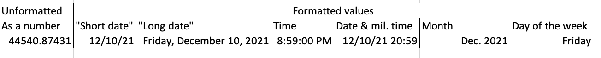
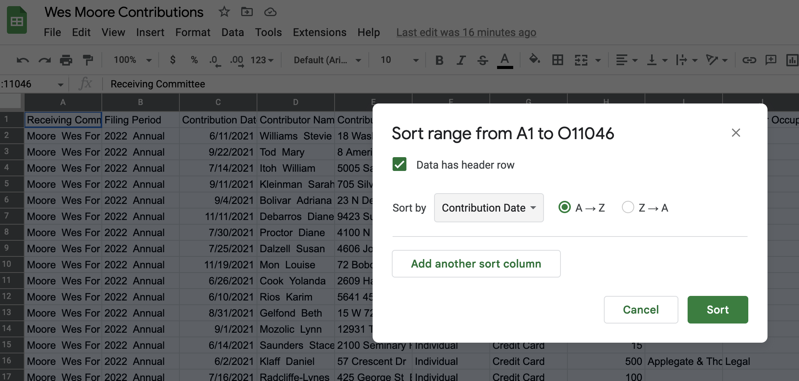
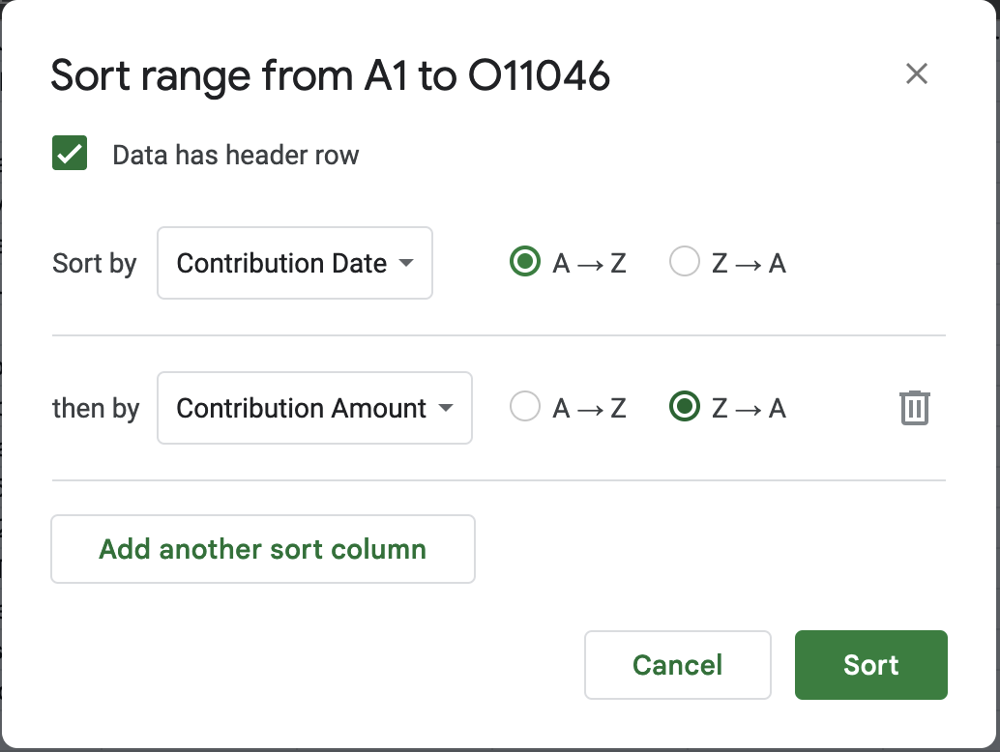
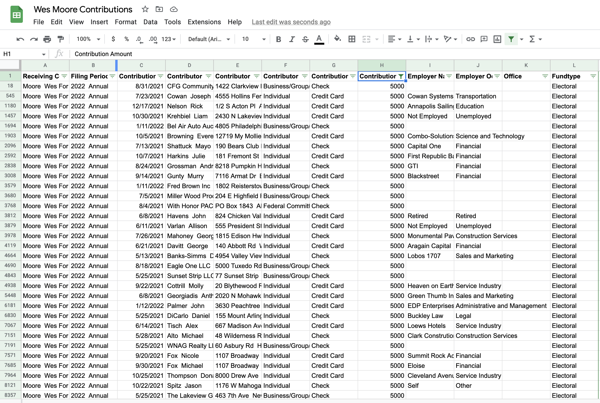
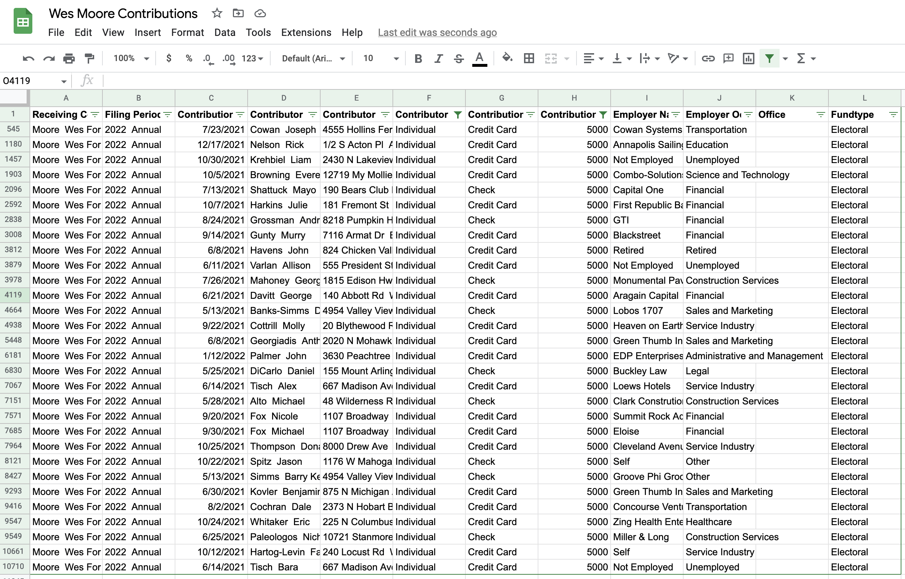
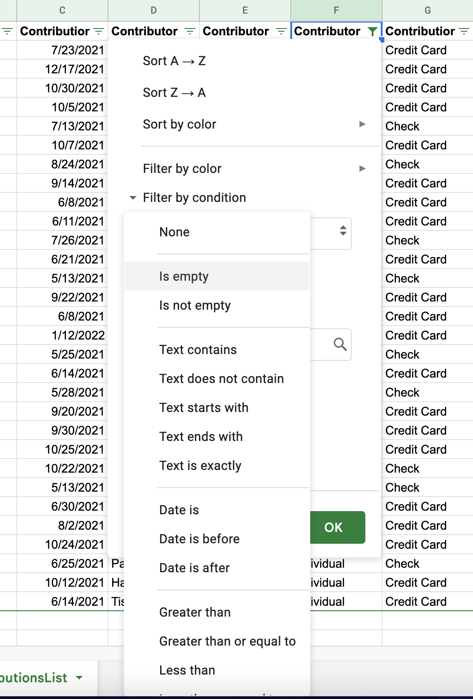

## A sorting miracle

In 2010, reporters at ProPublica wanted to know how much money drug companies were paying doctors to promote their products -- giving talks to other doctors over dinner, consulting and traveling to meetings. A handful of companies had started posting those payments online, each in its own format, so the reporters collected the lists into a single database they called "Dollars for Docs."

They weren't sure at first what they were looking for, so they started the way that many reporters do with data: by sorting and filtering. Who received the most money? Were there doctors on the lists who stood out for some other reason?

One of the things they found by working through the lists was that some of the doctors the companies paid to speak on their behalf had been disciplined by state medical boards. The project led to dozens of stories by ProPublica and its partners, and the federal government now publishes these payments for every drug and medical device company in the Open Payments database -- which is where the data for this tutorial comes from.

## Sorting and filtering as a reporting tool

Sorting and filtering can:

-   Narrow your focus to specific items that you want to examine in your story.
-   Show you rows containing the highest and lowest values of any column. That can be news or it can be errors or other problems with the data.
-   Let you answer quick "how many?" questions, with a count of the rows that match your criteria. (In the next lesson, you'll see that pivot tables, or group-by queries, are much more powerful for this in most cases.)

## Example data

::: {.alert .alert-info }
- [Data from Open Payments](https://openpaymentsdata.cms.gov/) for use in this tutorial: [`md_open_payments_2025_sheets.csv`](data/md_open_payments_2025_sheets.csv)
- [Documentation from Open Payments](https://www.cms.gov/priorities/key-initiatives/open-payments/data/dataset-downloads)
:::

-   The data for this is from the federal Centers for Medicare & Medicaid Services' Open Payments database. It includes every payment that drug and medical device companies reported making in 2025 to doctors, nurse practitioners, physician assistants and teaching hospitals in Maryland, except for food and beverages -- which are the vast majority of payments but a small share of the money. There are a couple of caveats:
-   The payments are reported by the companies, not by the people who received them. Recipients can dispute them, and companies can correct them.
-   It doesn't include everyone: some kinds of health care providers aren't covered by the law that created the database.

Download the CSV file to your computer and then, in a browser, type sheet.new to create a new Google Sheet. From there, use File -> Import and choose "Upload" and select the file on your computer. Click the "Import Data" button when it appears. Then give your sheet a name, like "Maryland Open Payments 2025". (The screenshots in this chapter come from an earlier version that used campaign contribution data, so the columns you see will be different.)

It's a good example set for us because it's the kind of data reporters use for stories about the influence of drug and device companies, and it has at least one of each *data type* that we plan to deal with in Google Sheets or Excel. And, critically, the first row contains headers, not data. Always have headers, even if you have to add them.

## Understanding data types

When you open the spreadsheet, the first thing to notice is its [*granularity*](start-data-def.html). Unlike Census or budget spreadsheets, this is a list capturing specific characteristics of each payment. Each column has the same *type* of data from top to bottom. Those types are:

-   **Text**. Text or "character" columns can come in long or short form. When they are standardized (the values can contain only one of a small list of values), they're called "categorical". If they're more free-form, they're might be called "free text". The computer doesn't know the difference, but you should. The Open Payments data has examples of both: `Nature of Payment` is categorical, while `Recipient Name` is free text. In spreadsheets, text is left-justified (they move toward the left of the cell and will line up vertically at the beginning)

-   **Numbers**. These are pure numbers with no commas, dollar signs or other embellishments. In Google Sheets these can be formatted to *look* like numbers in different ways, but underneath they're just numbers. Adding up a column of numbers that has a word in it or has missing values will just be ignored. It will trip up most other languages. These are right-justified, so the last digit is always lined up vertically.

-   **Logical**: This is a subset of text. It can take one of only two values -- yes or no, true or false. There is no "maybe".

-   **Date and times**: These are actual dates on the calendar, which have magical properties. Underneath, they are a number. In Google Sheets and Excel, that number is the number of days since Jan. 1, 1900.[^xl-filter-sort-2] They can also have time attached to them, which is a fraction of a day. What this means is that the number 44,536.5 is really Dec. 6, 2021 at noon. In Sheets, you use a format to tell the spreadsheet how you want to see the date or time, just the way you look at dollar values with commas and symbols. (If you get a spreadsheet with a lot of dates of 1/1/1900, it means there is a 0 in that column, which is sometimes a fill-in for "I don't know.")

[^xl-filter-sort-2]: Each language deals with dates and times a little differently. We'll see how R does it later on. But just know that dates can be tricky because of these differences and [time is even more tricky](https://infiniteundo.com/post/25326999628/falsehoods-programmers-believe-about-time)

Here's a picture of a date that is shown in a variety of formats.

{width="100%"}

All of these are the same, underlying value -- the number at the left. Notice that all of these are right-justified.

This means that when you see "Friday, December 10", the computer sees 44540.87431. When you put the dates in order, they won't be alphabetized with all of the Fridays shown together. Instead, they'll be arranged by the actual date and time.

It also means that you can compute 911 response times even when it crosses midnight, or or compute the someone's age today given a date of birth. Keeping actual calendar dates in your data will give it much more power than just having the words. (Sheets and Excel use the 1st of the month as a stand-in for an actual date when all you know is the month and year.)

### Sorting rows

Sorting means rearranging the rows of a data table into a different order. Some reporters take a conceptual shortcut and call this "sorting columns". That thinking will only get you into trouble -- it lets you forget that you want to keep the rows in tact while changing the order in which you see them. In fact, in other languages it's called "order by" or "arrange" by one or more columns -- a much clearer way to think of it.

To sort in Google Sheets, first highlight the entire sheet by clicking on the button above the first row and to the left of the first column. So, between the 1 and the A. Then, look for the sort options under the Data drop-down menu at the top of your screen, and choose "Sort Range" and then "Advanced range sorting options". Trust me, this is how you want to do it. Check the box that says "Data has header row" and Sort by Date of Payment. In this case, sorting from A to Z gives you a list of the payments in chronological order.

{width="80%"}

#### Adding fields to the sort {.unnumbered}

Adding more columns to the sort box tells Sheets what to do when the first one is the same or tied. For example, sorting first by date then by amount gives you a list that shows all of the payments by date in sequence, with the biggest payments each day at the top or bottom:

{width="50%"}

### Filtering

Filtering means picking out only some of the rows you want to see based on a criteria you select in a column. Think of it as casting a fishing net -- the more filters you add, the fewer fish will be caught.

To turn on filters in Google Sheets, go to Data -> Create a filter. It will add small down arrows to each column in the first row, another reason why headers are crucial. You can filter by multiple columns, and each filter you select adds more conditions, narrowing your net.

To find consulting fees, use the drop-down menu under `Nature of Payment` to select "Consulting Fee" and hit "OK".

When you do this, notice that the drop-down arrow has turned into a solid green funnel and that any rows that don't match your filter are hidden.

::: {.alert .alert-warning}
This method works for small-ish and simple-ish columns. If your column has more than 10,000 different entries, such as names or addresses, only the first 10,000 will be considered. We only caught these for stories when someone did a fact-check using a different method of filtering. If your column has a lot of distinct entries, use option that says "Choose One", and then use the "Contains" option. Better yet, don't use filtering for counting things at all.
:::

Add more filters to narrow down your list of cases even more. For example, if you wanted to see consulting fees paid to physicians, you would also choose "Physician" under Recipient Type:

#### Different kinds of filters {.unnumbered}

There are several options under the filter drop-down menu under "Filter by condition", and you also can type values into a search box to try and filter that way (the latter option is best for text columns). There also is a "Filter by color" option. My opinion: don't do this.

{width="30%"}
## FAQ

### How do I turn off all of my filters {.unnumbered}

In the data tab, chose "Remove filter" to remove all of the filters.

### Where is the button to filter *columns*? {.unnumbered}

Sometimes you don't want to see all of your columns -- there are too many and they're getting confusing. There is no column filter in Sheets or Excel (You'll see how to filter, or "Select", columns from a dataset in R later.)

Instead, you can hide the columns you don't want to see. When columns and rows are hidden, they generally won't copy to a new sheet.