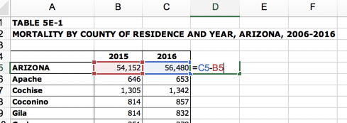
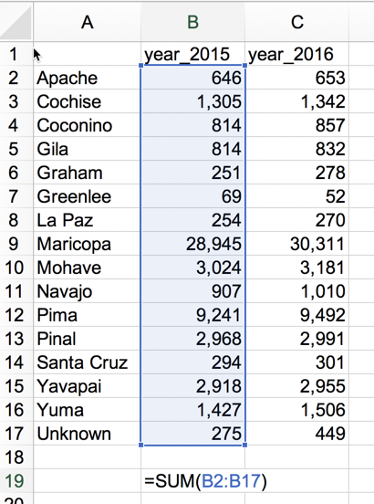
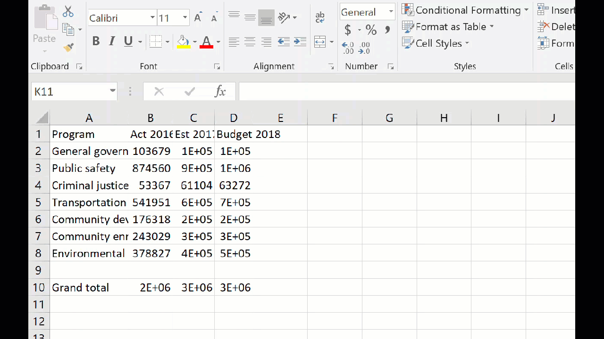
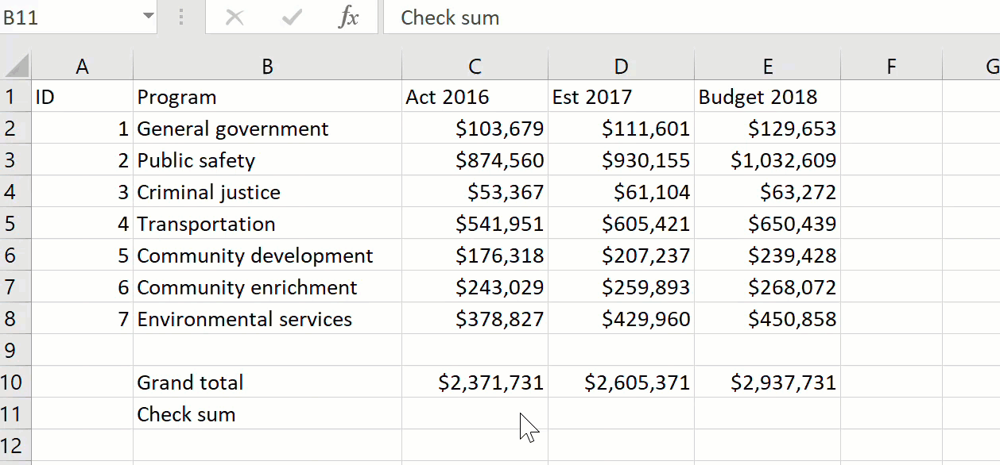
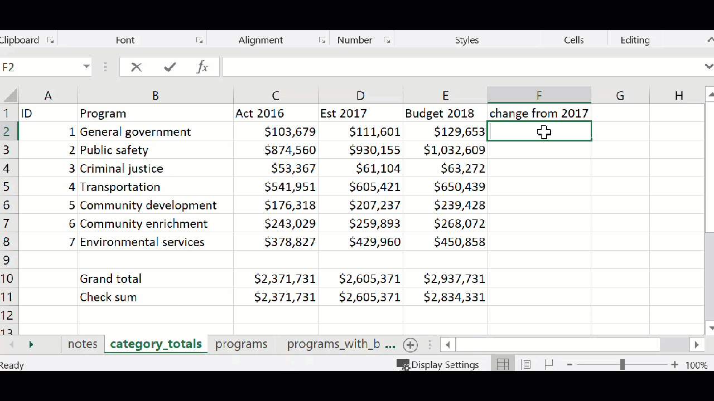
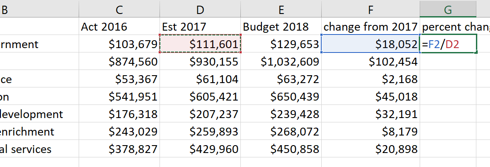
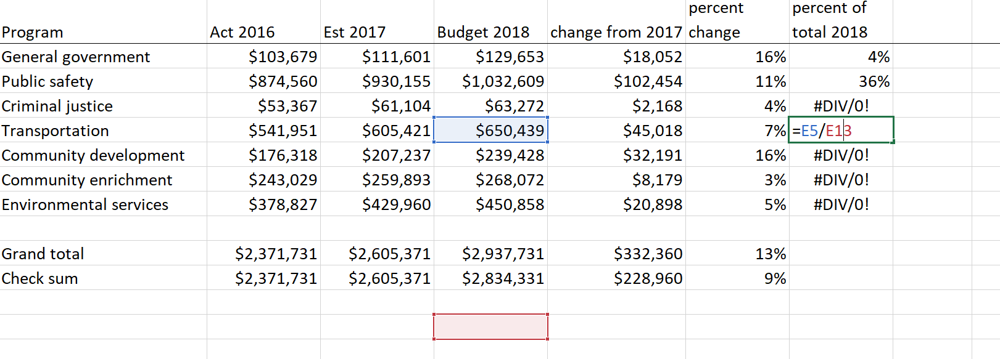
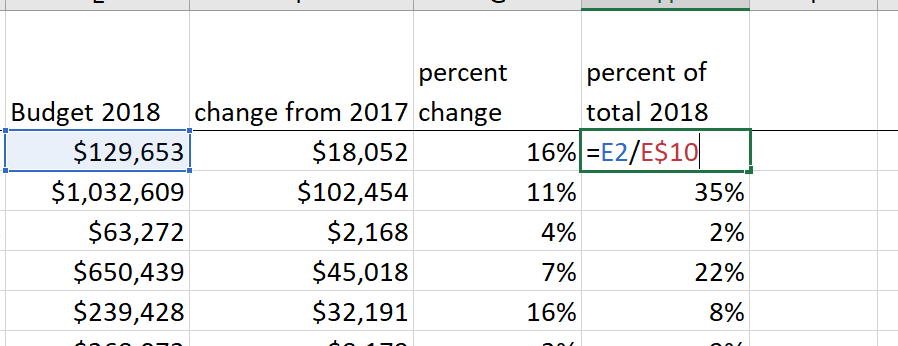
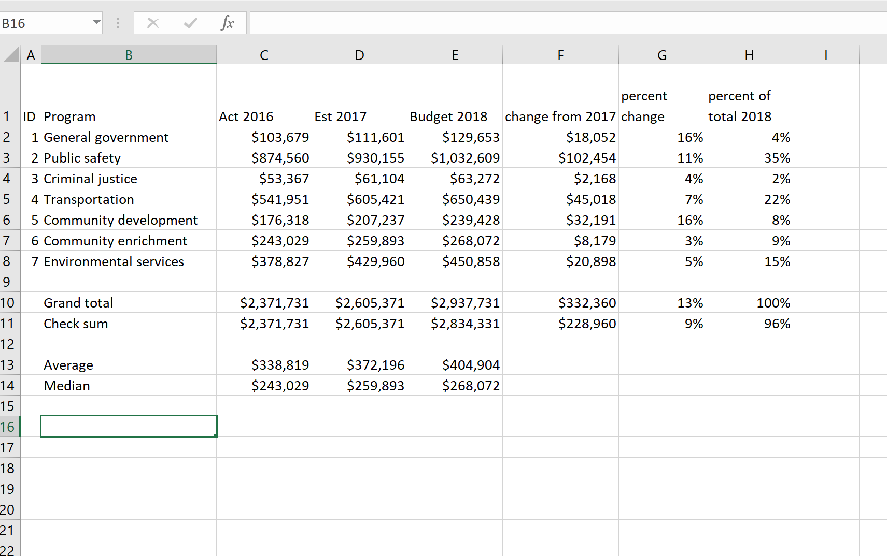

The quick review of math in Google Sheets uses the Maryland Department of Health's count of drug- and alcohol-related intoxication deaths by substance for 2014 through 2016, the years when fentanyl began driving the state's overdose crisis.

::: {.alert .alert-info .opacity-2}
Import [`md_intoxication_deaths_2014_2016.csv`](data/md_intoxication_deaths_2014_2016.csv) from the `data` folder of the course repository into a new Google Sheet (type sheet.new in your browser, then use File -> Import) to follow along. It comes from two datasets on [Maryland's open data portal](https://opendata.maryland.gov/). The screenshots in this chapter come from an earlier version that used a city budget, so they'll look different from your sheet, but the formulas work the same way.
:::

You should get into the habit of creating unique identifiers, checking your corners and looking for documentation before you ever start working with a spreadsheet. These habits were covered in [Data journalism in the age of replication](replication.html) and on [a Google Sheets refresher](xl-refresher.html).

## Formulas in spreadsheets

Whether you use Google sheets or Excel, remember that every formula begins with the equals sign **(=)**. Rather than the values you want to work with in the formula, you'll use *references* to other cells in the sheet.

The easiest formulas are simple arithmetic: adding, subtracting, multiplying and dividing two or more cells. You'll just use simple operators to do this:

| operator       | symbol | example |
|----------------|--------|---------|
| addition       | \+     | =A2+B2  |
| subtraction    | \-     | =A2-B2  |
| multiplication | \*     | =A2\*B2 |
| division       | /      | =A2/B2  |

Here's what a spreadsheet looks like while editing some simple arithmetic:

The other kind of formula is a *function*. A function is a command that has a name, and requires *arguments* -- usually the cell addresses or the range of addresses that it will act on. Every programming language has functions built in and many have extensions, or packages or libraries, that add even more as users find things they want to do more efficiently. You begin using a function the same way you begin a formula -- with an = sign. Here are three common functions that create summary statistics for the numbers contained in a *range* of addresses. A range is a set of cells defined by its corner cell address: the top left through the bottom right.

You'll usually use them on a single column at a time.

| Formula                | What it does                                     |
|------------------------|--------------------------------------------------|
| =SUM(start:finish)     | Adds up the numbers between `start` and `finish` |
| =AVERAGE(start:finish) | Computes the mean of the numbers                 |
| =MEDIAN(start:finish)  | Derives the median of the numbers                |

...where "start" means the first cell you want to include, and finish means the last cell. Use the cell address of the first number you want to include , a colon, then the cell address of the last number you want to include. You can also select them while you're editing the formula.

Here's an example of adding up all of the rows in a list:

## Common spreadsheet arithmetic

The data shows three years' worth of deaths in which each of six substances was involved: heroin, fentanyl, alcohol, cocaine, prescription opioids and benzodiazepines (sedatives such as Xanax and Valium). The last row is the state's total number of accidental or undetermined intoxication deaths for each year.

You may want to widen the columns and format the numbers before you start:

::: col-12
{width="100%"}
:::

### Check the math with SUM

Our first job is to see whether the data adds up the way we'd expect. To do that, we'll SUM the deaths for all of the substances.

To add up the numbers from 2014, enter the following formula in cell B10, a couple of rows below the total provided by the state:

      =SUM(B2:B7)
      and hit the enter key

Copy that formula to the right. Notice how the formula changes the addresses that it is using as you move to the right -- it's adjusted them to refer to the current column.

::: col-12
{width="100%"}
:::

What's wrong? The substances add up to far more than the total -- in 2016, nearly twice as much. Is the state's total wrong? No. Many people who die of an overdose have more than one drug in their system -- heroin *and* fentanyl, or cocaine *and* alcohol -- and the health department counts that death once for each substance involved. The total counts each person once. This is a good example of why you should always read the documentation before you add things up: the right answer to "how many people died?" is the total, not the sum.

### Change in deaths

The increase or decrease in deaths from 2015 to 2016 is just the difference between the two values, beginning in cell E2

      new-old, or  =D2-C2

When you copy it down, note how the references to each row also adjusted. In line 3, it's D3-C3, and so on. Excel and other spreadsheets assume that, most of the time, you want these kinds of adjustments to be made.

{width="100%"}

### Percent change

We can't tell the *rate* of growth for each substance until we calculate the percent change from one year to another. Now that we already have the change, the percent change is easy. The formula is:

      ( new - old ) / old

      .. or just scream "NOO"

The new-old is already in column E, so all that's left is to divide again: =E2/C2 in column F. In grade school, you also had to move the decimal place over two spots, since the concept of percent change is "out of 100". Excel formats will do that for you.

Remember, it's always (new-old)/old , **NOT** the big one minus the little one. Doing it correctly, the answer could be negative, meaning the value fell.

::: col-12
{width="100%"}
:::

When you're done, you can format the answer as a percentage to get it into whole numbers.

Until you get used to it, there's no harm in doing these calculations step by step. Excel won't complain if you have extra columns. You can always hide them.

It's also worth comparing the picture you get by looking at raw numbers vs. percentages. In our case, heroin deaths rose by 464 from 2015 to 2016, which sounds enormous -- but fentanyl deaths rose by 779, more than tripling. That's a percent change of nearly 230%, by far the largest of any substance, and it's why fentanyl became the story of Maryland's overdose crisis.

### Parts of a whole: percent of total

We'd also like to know what portion of all deaths involved each substance. To do that, we need the percent of total.

In our case, let's use the total that the state gave us -- the number of people who died, not the sum of the substances. In practice, you'd have to decide what to do if your figures didn't match those provided by officials. You can't assume that the total is wrong -- you could be missing a category, or, as here, the categories could overlap. Because they overlap, our percentages will add up to more than 100%, and you'd write that "fentanyl was involved in 54% of deaths," not that it "caused" them.

The formula for percent of total is:

      category / total

Again, Excel will multiply by 100, or move the decimal place over for you once you format.

But you have a problem: You either have to type in each row, or you get something like this if you try to copy:

::: col-12
{width="100%"}
:::

Excel has done its magic, adjusting the location of both the numerator and the denominator when you copied. You don't have to type in each formula one by one, though. Instead, you'll use anchors, known in spreadsheets as "absolute references". Think of a dollar sign as an anchor or stickpin, holding down the location of part of your formula. If you put the stickpin before the letter in the formula, it holds the column in place. If you put it before the number, it holds the row in place. If you put it in both places, it holds the cell in place.

So our new formula for the percent of total for 2016, starting in row 2, is `=D2/D$8` -- the dollar sign holds the total in row 8 in place as you copy the formula down. Here is how that looks in a sheet:

::: col-12
{width="100%"}
:::

## While we're at it: two kinds of averages

Although it doesn't make a lot of sense in this context, we'll go ahead and calculate the *average* or *mean* number of deaths per substance, and then calculate the *median*.

**Simple average, or mean**

A simple average, also known as the mean, is skewed toward very high or very low values. Its formula is

        sum of pieces / # of pieces that were summed

But in Excel, all we need is the word AVERAGE:

        =AVERAGE(D2:D7)

**Median**

In Excel, you can get the median of a list of numbers by just using the formula, MEDIAN()

      = MEDIAN(D2:D7)

## The final spreadsheet

::: col-12
{width="100%"}
:::

Doing simple calculations like this on data that is provided to you by the government lets you ask better questions when you get an interview, and may even convince officials to talk with you. There's a big difference between asking them to tell you what the overdose numbers are, and asking them to explain specific results!

## FAQs

#### Sheets won't let me copy my formula {.unnumbered}

Make sure your formula is locked in by either hitting "Enter" or "Escape". This is a common problem if you're in the habit of double-clicking instead of selecting a cell. There are a lot things you can't do while Excel thinks you're still entering information.

#### Should I use average or median? {.unnumbered}

It depends. Averages are easier to explain but can be misleading. Usually, if they're very different, median will be a better representation of the typical person, city or category. Averages in these cases are more like totals.

#### My percents are small numbers with decimal points {.unnumbered}

Use the format as a % button to move the decimal point over two places and insert the percentage symbol.
