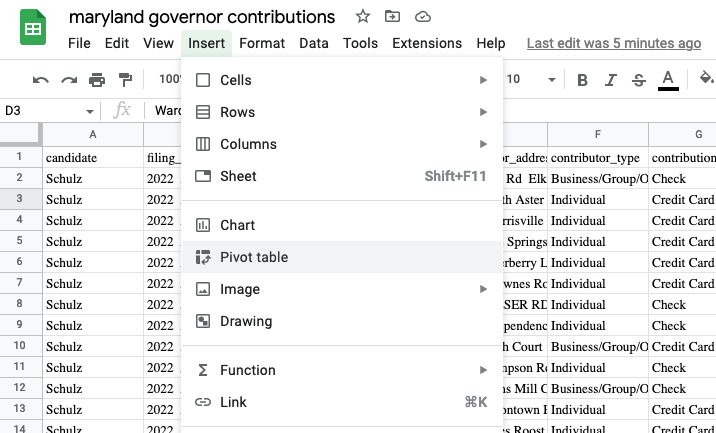
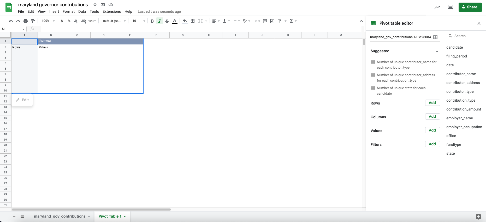
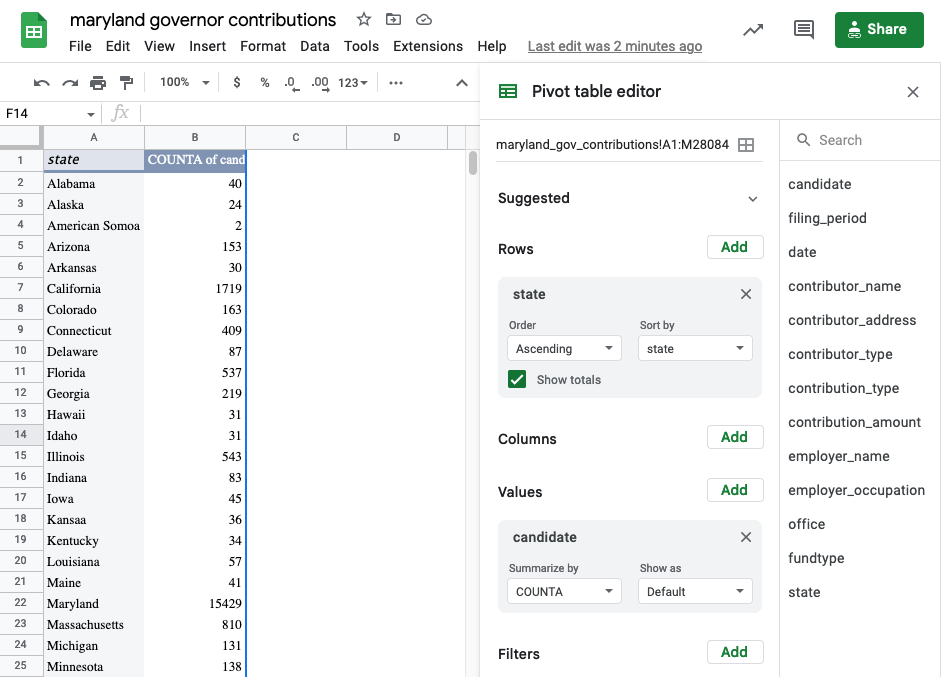
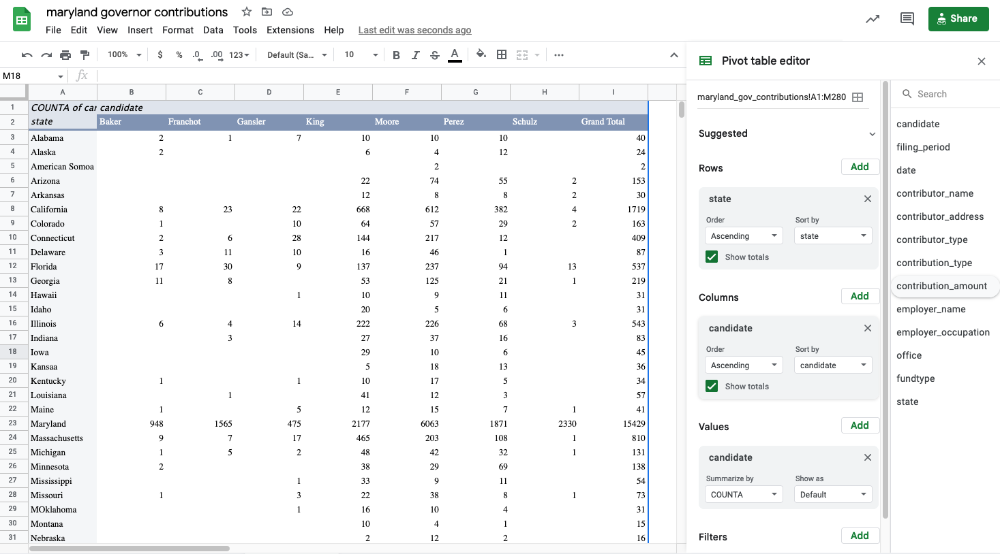
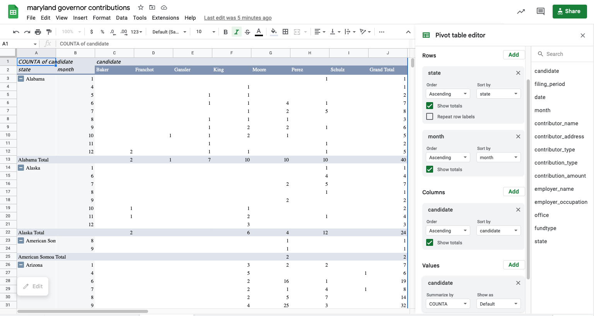

# Grouping with pivot tables {#xl-pivot}

Let's keep working with the Open Payments data from the previous chapter: payments that drug and medical device companies made in 2025 to Maryland doctors, nurse practitioners, physician assistants and teaching hospitals, other than food and beverages. Open the Google Sheet you made from `md_open_payments_2025_sheets.csv` (or import it again).

Stories about these payments almost always start with totals:

> How much did each company pay Maryland health care providers last year?
>
> What kinds of payments -- consulting, speaking, travel, royalties -- account for the most money?
>
> Which specialties get the most payments, and from whom?

Summarizing a list of items in a spreadsheet is done using pivot tables. In other languages, it's considered "aggregating" or "grouping and summarizing". Think of pivot tables and grouping as answering the questions, "How many?" and "How much?". They are particularly powerful when your question also has the words "the most" or the "the least" or "of each". Some examples:

-   Which *Zip Code* had *the most* crimes?
-   What *month* had *the least* total rainfall?
-   *How much* did *each company* pay doctors last year?
-   In playing cards, *how many* of *each suit* do I have in my hand?
-   On average, are *Merrill students* *taller or shorter* than in other schools?

### Confusing grouping with sorting or arranging {.unnumbered}

Many reporters confuse this summarization with "sorting". One reason is that this is how we express the concept in plain language: "I want to sort Skittles by color".

But in data analysis, sorting and and grouping are very different things. *Sorting* involves shuffling a table's rows into some order based on the values in a column. In other languages, this is called *arranging* or *ordering*, much clearer concepts. *Grouping*, which is what pivot tables do, is a path to aggregating and computing summary statistics such as a count (the number of items), sum (how much they add up to), or average for category. It means "make piles and compute statistics for each one."

### When to use filter vs. pivot tables {.unnumbered}

Something that trips up beginners is a desire to see details and totals at the same time, which is more difficult than it sounds.

A filter is used to *display* your selected items as a list. You'll get to see all of the detail and every column. As a convenience, Excel shows you how many items are in that filtered list. That's great when you want to just look at them, or get more information about them. For instance, if you had a list of crimes by ZIP code, you might just want to see the list in your neighborhood -- where, exactly, were they? When did they happen? Was it at night or the morning? What crimes happened on which blocks?

A pivot table is used when you *just want to see summaries* -- does my ZIP code have more crime than others? Are robberies more common than car theft in my Zip code, and how does that compare to others?

In practice, you'll go back and forth between summary and detail. They're both important, just different.

## Tutorial

### Setting up the pivot table {.unnumbered}

Start with your cursor somewhere in your data , and choose *Insert*, then *Pivot table*. Then hit the *Create* button.

If all goes well, it will look like your data disappeared. It didn't -- you're just on a new page. Here's what it looks like:

{width="100%"}

### Counting , or "how many"? {.unnumbered}

The section on the right gives you an outline of what to do. The section on the left will get filled in as you make your pivot table. If you want to see the number of payments of each kind, drag the `Nature of Payment` column into the "Rows" area, then drag something that's always filled out into the Values area (`Company` is a safe one in this data). (As in the previous chapter, the screenshots come from an earlier version that used campaign contribution data, so your columns will be different.) Travel and lodging is the most common kind of payment. Now change the Values area to show the SUM of `Amount` instead: is the most common kind of payment also the one with the most money?

{width="100%"}
### More variables {.unnumbered}

Suppose you'd like to see the number of payments by type of recipient, with the recipient types across the top and the `Nature of Payment` down the sides. Drag the `Recipient Type` variable into the column area. Sorting can get hinky on pivot tables, but in this case it will work to put the largest number on top. This won't work with percentages -- it still sorts by the underlying number.

{width="100%"}

### Even more variables {.unnumbered}

Say you wanted to see each company's total payments by nature of payment and recipient type.

This isn't always easy to organize. It means you'd need to have a pivot table with TWO columns down the side, and one across the top. Here's my attempt at getting there:

{width="100%"}

This is after some fiddling with the formats, and I still can't sort properly. We can't sort by the combination of two row variables.

Your choices here are limited: Copy and paste the values of the pivot table into a new sheet and sort there, or create a new variable by concatenating the two values into one column.

## FAQ

### Everything disappeared! {.unnumbered}

If you select something outside of that pivot table on the left, the menu on the right disappears. Select something in the pivot table area and it will likely come back.

### I have too many columns {.unnumbered}

If you want two sets of statistics -- say, number of payments and percent of payments -- across the top, it can get very wide and confusing very quickly. One alternative is to change it into more of a vertical rectangle by dragging the "Values" element from the columns to the rows on the right. (This only shows up when you have two calculations being made.)

### Things aren't adding up {.unnumbered}

You have to be super careful about which column you use to Count things -- it has to always be filled out (there can't be any blanks). Go through the filters and find one that doesn't have (Blanks) at the bottom to be sure.

### Its a crazy number! {.unnumbered}

You might have dragged a numeric column into the "Values" area. Check to see if it says "Count" or "Sum". Change it to "Count" if it has something else on it, unless you wanted to add up that column.

### This is so frustrating - I can't get what I want {.unnumbered}

Right? It's time to go to a programming language!
